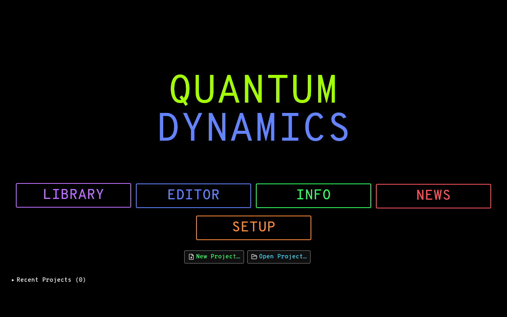
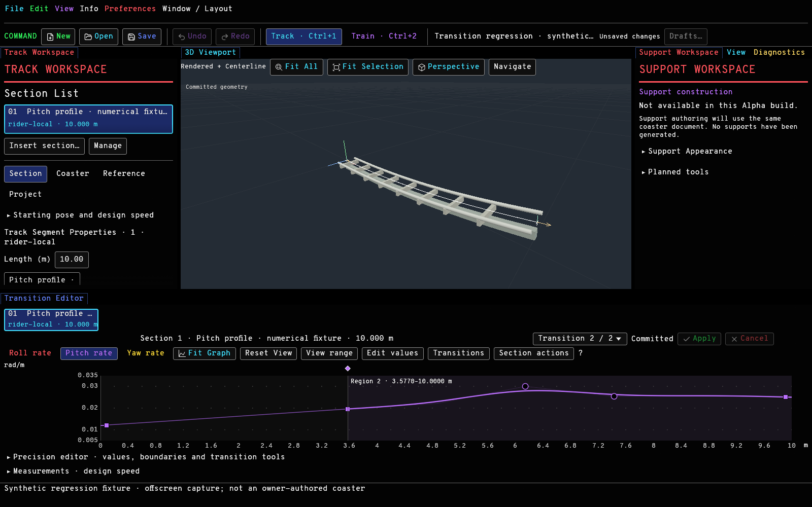

# QUANTUM Dynamics

**QUANTUM Dynamics** is an independent, open-source, native desktop application in
Alpha development for designing, editing, visualizing and simulating roller
coasters. **QUANTUM-X** is its Rust development repository. The application uses
**Rust 2024, wgpu and egui**, with Windows as the primary desktop target.

Track authoring is graph/timeline-first: a person defines ordered sections,
force/rate profiles and transitions, then inspects the generated 3D geometry.
Complementary geometric curves share the same downstream track representation.
This is a standalone application; it is not a plugin or a park-management game.

**Current status: source development Alpha.** The repository contains working
editor and numerical systems alongside experimental features. This update is
source publication, not an official public Alpha release. No downloadable build
is supplied by this update; see the local portable-build instructions below.

## Application captures

Authentic offscreen captures of the current native wgpu/egui application,
generated on Windows on 2026-10-30 without desktop input or image retouching.





The Editor image shows a **synthetic numerical regression fixture**, not a
finished coaster design. Its generic procedural track is development content;
the visible Support Workspace explicitly reports that construction is unavailable.

## What works today

- **Welcome and project startup:** owner-directed Welcome Screen, New/Open,
  Recent Projects with moved-file recovery, installed diagnostic samples and
  application setup. Editor navigation alone creates no project; New Project
  asks for a name and starts with an editable 10 m straight and unassigned style.
- **Native Editor:** colorful, high-contrast owner-directed presentation,
  Overpass Mono, curated Lucide/Carbon icons, central 3D viewport, Track and Train
  Workspaces, docked/tabbed/resizable panes, internal floating panes, UI scaling,
  keyboard commands and precision numeric editing.
- **Coaster Properties:** name, description, family and numbered-style assignment
  with Apply/Cancel and undo/redo. Catalog assignment stays separate from track
  construction and vehicle mechanics. Each project currently holds one coaster.
- **Track and transition authoring:** ordered force-vector, geometric and
  rider-local sections; distance/time domains; cubic scalar NURBS regions;
  shape-preserving split and compatible merge; shared-boundary edits under
  explicit C0/C1/C2/Free contracts; direct shape controls, graph context menus,
  Shift fine dragging, zoom/pan and numeric input. Edits preview through the
  generation worker and use transactional Apply/Cancel and undo/redo.
- **Complementary geometry:** distinct Bezier, B-spline, positional NURBS and
  Catmull-Rom representations, f64 evaluation and derivatives, arc-length
  traversal, transported frames, rider-reference geometry and diagnostics.
- **Procedural rendering:** generic single/dual-rail construction, hardware and
  material settings, solid/centerline/technical/mesh-edge views, camera controls
  and offscreen wgpu/egui captures. These validation configurations are not
  finished manufacturer-specific catalog styles.
- **Train infrastructure:** persisted component/multi-car definitions, validated
  static GLB import, visual mounting transforms and kinematic inspection.
  Optional development tools expose experimental rigid-body playback with
  gravity, joints, hinges, limits and bounded motors at a fixed **1/240 s** step.
- **Projects and verification:** versioned `.qx.json` storage, explicit migration
  from schemas 1–5 to schema 6, validation, save/reopen tests, CSV/OBJ/SVG
  diagnostics and independent numerical verifiers.
- **Windows identity and packaging:** original owner-approved embedded executable,
  window and taskbar icon; portable staging with catalog/assets, sample projects,
  license notices and noninteractive startup/resource checks.

## Experimental and incomplete

- Vehicle playback uses **idealized captive centerline constraints**. Wheel/rail
  contact, collisions, complete articulated train dynamics, operational systems
  and validated environmental models remain incomplete. Authored design-speed
  loads and kinematic inspection are distinct from physical train simulation.
- Included GLB train bodies/bogies and mechanical configurations are explicitly
  **development fixtures**, not finished production train models.
- The catalog registers **6 track families / 17 numbered styles** and **14 train
  families / 11 named or numbered styles**. All catalog styles are **Planned**;
  there are zero available production styles. Empty asset folders do not supply
  models, previews, mechanical properties or validated compatibility.
- Support Workspace organization exists; **support authoring is unavailable**.
  News, ride operations, multi-coaster projects and mechanical 4D transmission
  playback are also unavailable. Mechanical 4D playback is rejected explicitly.
- Final interaction feel, high-DPI presentation and native desktop behavior still
  need owner testing. Automated offscreen rendering is not manual UX validation
  or an FPS benchmark. No performance or ride-safety certification is claimed.

## Build and run on Windows

Install a current stable Rust toolchain for `x86_64-pc-windows-msvc`, Visual Studio
Build Tools with **Desktop development with C++**, and the Windows SDK (including
its resource compiler). A GPU/driver supporting wgpu's Vulkan or DirectX 12
backend is needed for rendering. Python 3 is used by the numerical verifiers;
Blender is not required to build or run the application.

```powershell
git clone https://github.com/Coasterpete/QUANTUM-X.git
cd QUANTUM-X
cargo build --workspace --release --locked
cargo run --release -p quantum-x -- edit
# Or open an existing project:
cargo run --release -p quantum-x -- edit examples/mixed-authoring.qx.json
```

`edit` enters the direct development editor. To start the branded application at
Welcome with no document, build a local portable folder:

```powershell
./tools/package-windows.ps1
& './target/distribution/QUANTUM Dynamics-0.1.0-windows/QUANTUM Dynamics.exe'
```

Packaging refuses an existing destination. For another build, choose a new path
with `-OutputDirectory target/my-new-distribution`. Keep its `assets` directory
beside the executables. Both `QUANTUM Dynamics.exe` and `quantum-x.exe` accept the
development CLI; no-argument `quantum-x.exe` prints CLI help. The portable build
is unsigned and has no installer, updater or file associations. Packaging does
not publish a GitHub Release or upload binaries. Linux/macOS support is not
claimed by the Windows verification.

## First authoring steps

Create a named project from Welcome, then use the Track Workspace and timeline
to select or insert sections. Edit channel values and regions in the Transition
Editor, or use numeric controls. Apply publishes a draft; Cancel restores its
committed values. Ctrl+S saves, Ctrl+Shift+S saves as, Ctrl+O opens, Ctrl+Z/Y
undo/redo, and Ctrl+Enter applies a section. Graph Ctrl+wheel zooms, middle drag
pans, and F fits the hovered graph or viewport. Edit → Coaster Properties sets
coaster identity and catalog intent. Save a copy before migrating older projects:
older application versions cannot read new schema-6 NURBS regions.

`View → Development tools` exposes experimental train fixtures, mechanics and
playback. Library samples and exported scenarios are numerical fixtures, not
finished coaster designs or automatic layout recommendations.

## Verification

Run from the workspace root on native Windows:

```powershell
cargo fmt --all -- --check
cargo check --workspace --locked
cargo clippy --workspace --all-targets --locked -- -D warnings
cargo test --workspace --locked
cargo build --workspace --release --locked
./tools/package-windows.ps1 -OutputDirectory target/verification-distribution
./tools/verify-owner-ui.ps1 -Executable 'target/verification-distribution/QUANTUM Dynamics.exe' -OutputDirectory target/verification-workflows
./target/release/quantum-x.exe transition-scenario target/verification-transitions
python tools/verify-transition-reference.py target/verification-transitions
./target/release/quantum-x.exe examples target/verification-examples
python tools/verify-authoring-exports.py target/verification-examples
./target/release/quantum-x.exe heartline-demo target/verification-heartline
python tools/verify-heartline-exports.py target/verification-heartline
```

Use fresh output directories. The packaged workflow script runs physics,
authoring, procedural track, GLB train assets, rigid-body playback and UI scenarios
outside the checkout, then checks their exports independently. It does not send
input to the Windows desktop. See the [publication verification report](docs/publication-2026-10-30.md)
for executed checks and manual limitations.

## Development documentation

- [Owner-designed Welcome and Editor](docs/ux/owner-mockups.md),
  [startup workflow](docs/welcome-startup.md), and
  [Coaster Properties specification](docs/ux/coaster-properties.md).
- [Scalar NURBS transitions, continuity and schema migration](docs/transition-nurbs-regions.md)
  and [C++ reference study / latest Rust interaction improvements](docs/transition-cpp-reference-report.md).
- [Procedural track construction](docs/m7-procedural-track-engine.md),
  [GLB assets and rigid-body foundations](docs/m8-rigid-body-foundation.md), and
  [experimental vehicle playback](docs/m82-universal-vehicle-playback.md).
- [Catalog and asset contracts](docs/library-catalog.md),
  [approved Windows icon](docs/windows-icon.md), and
  [core math and coordinate conventions](docs/core-foundation.md).

The application lives in `apps/quantum-x`; geometry, documents, physics, catalog,
rendering and audio have separate workspace crates. Historical pass reports
record their own verification snapshots; generated `target/` evidence is local
and is not distributed with source. The original C++ reference project is
separate from this Rust workspace and is not needed to build it.

## License

The existing project licenses remain **MIT OR Apache-2.0**; see
[LICENSE-MIT](LICENSE-MIT) and [LICENSE-APACHE](LICENSE-APACHE).
Third-party fonts and curated icons retain their bundled license notices.
