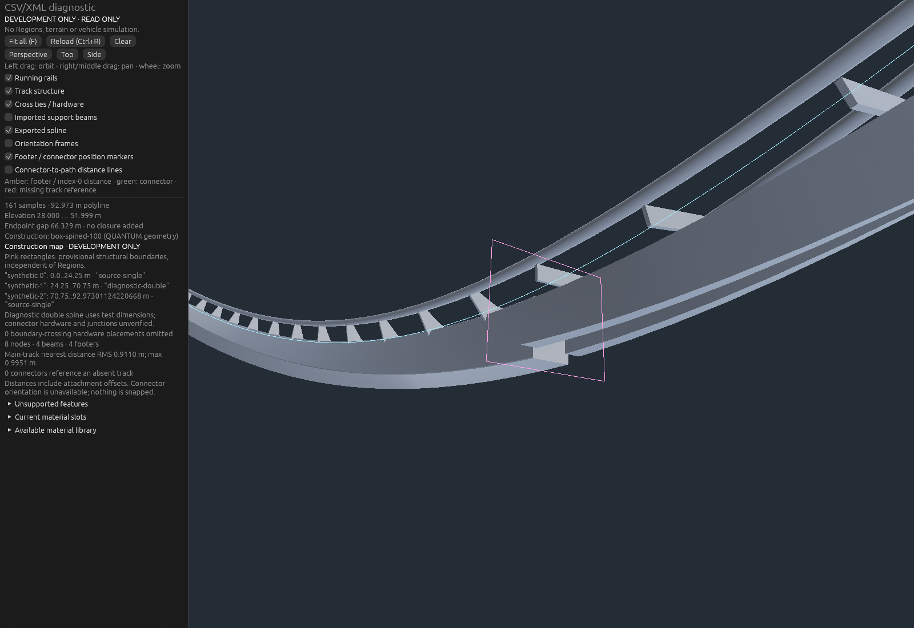

# M1.3 original synthetic offscreen evidence

All images use the redistributable synthetic CSV/XML under
`crates/qx-geometry/tests/import-fixtures`. No private NL2 export or screenshot
is included. These are actual wgpu offscreen renders, not UI mockups. Before and
after use identical sampled geometry and cameras. This intentionally banked and
inverted fixture is numerical test data, not a finished coaster design.

| View | Full source-single construction | Segmented source-single / diagnostic-double |
| --- | --- | --- |
| Whole imported layout, supports visible | [Before](before-overview.png) | [After](overview.png) |
| Compatible boundary at 24.25 m | [Before](before-boundary.png) | [After](after-boundary.png) |
| Middle of inverted double-spine interval | [Before](before-double.png) | [After](after-double.png) |

Structural detail captures hide supports and connector crosses to reveal the
spines; the overviews retain the same original supports. Pink rectangles identify
provisional capped structural terminations requiring an explicit junction
specification/asset. They are independent of authored Regions. Two running rails
continue through both spine configurations; rail data is exactly equal to the
baseline. No certified connector, weld or manufacturer-equivalent joint is implied.

See [implementation, commands and measurements](../../m1.3-segmented-construction.md).
Native GUI interaction was not manually verified; no active-desktop control was used.
